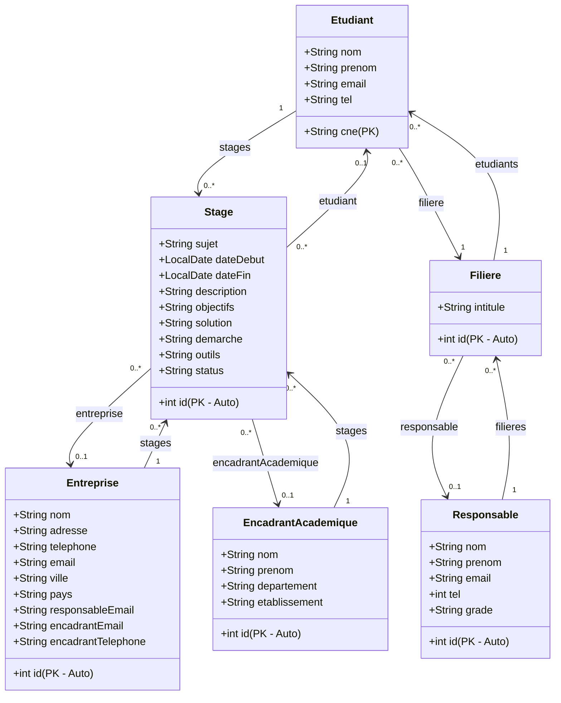

# Gestion des Stages API — Technical Documentation

A backend RESTful Web Service built using Spring Boot to manage academic internships (stages) for students. The API facilitates coordination among students, hosting companies (entreprises), academic supervisors (encadrants académiques), and department/program heads (responsables).

---

## 🛠️ Technology Stack

| Technology | Detail / Version | Purpose |
| :--- | :--- | :--- |
| **Java** | Version 25 | Programming language runtime |
| **Spring Boot** | Version 3.5.14 | Application framework |
| **Spring Data JPA** | Integrated with Hibernate | Relational persistence and ORM |
| **Database** | MySQL | Persistent relational database |
| **Lombok** | Compile-time annotations | Removes boilerplate (getters, setters, constructors) |
| **OpenPDF** | Version 2.0.3 | PDF report generation (Apache 2.0 licence) |
| **Springdoc OpenAPI** | Version 2.8.8 | Auto-generated OpenAPI 3 / Swagger UI docs |
| **Build Tool** | Apache Maven | Project build and dependency management |

---

## ⚙️ Configuration & Database Setup

The application connects to a MySQL database configured in [application.properties](file:///c:/Users/Mohammed/Projects/gestion_stages/src/main/resources/application.properties):

* **Database URL**: `jdbc:mysql://localhost:3306/ges_stages_db`
* **Username**: `root`
* **Password**: *[empty]*
* **Hibernate DDL Auto**: `update` — schema is created/updated automatically on startup
* **SQL Logging**: Enabled (`spring.jpa.show-sql=true`) for development monitoring

---

## 🗄️ Domain Architecture & JPA Entities

All models live under the `model` package.



### Entity Reference

| Entity | Primary Key | Notable Fields | Relationships |
| :--- | :--- | :--- | :--- |
| [Etudiant](file:///c:/Users/Mohammed/Projects/gestion_stages/src/main/java/com/example/gestion_stages/model/Etudiant.java) | `cne` (String) | nom, prenom, email, tel | OneToMany → Stage; ManyToOne → Filiere |
| [Stage](file:///c:/Users/Mohammed/Projects/gestion_stages/src/main/java/com/example/gestion_stages/model/Stage.java) | `id` (Auto int) | sujet, dateDebut, dateFin, status (`UNASSIGNED`\|`ACTIVE`\|`COMPLETED`\|`CANCELLED`), description, objectifs, solution, demarche, outils | ManyToOne → Etudiant, Entreprise, EncadrantAcademique |
| [Entreprise](file:///c:/Users/Mohammed/Projects/gestion_stages/src/main/java/com/example/gestion_stages/model/Entreprise.java) | `id` (Auto int) | nom, adresse, ville, pays, responsableEmail, encadrantEmail | OneToMany → Stage |
| [EncadrantAcademique](file:///c:/Users/Mohammed/Projects/gestion_stages/src/main/java/com/example/gestion_stages/model/EncadrantAcademique.java) | `id` (Auto int) | nom, prenom, departement, etablissement | OneToMany → Stage |
| [Filiere](file:///c:/Users/Mohammed/Projects/gestion_stages/src/main/java/com/example/gestion_stages/model/Filiere.java) | `id` (Auto int) | intitule | OneToMany → Etudiant; ManyToOne → Responsable |
| [Responsable](file:///c:/Users/Mohammed/Projects/gestion_stages/src/main/java/com/example/gestion_stages/model/Responsable.java) | `id` (Auto int) | nom, prenom, email, tel, grade | OneToMany → Filiere |

---

## 🔄 Data Transfer Objects (DTOs)

DTOs under the `dto` package support partial updates and the dashboard response shape.

| DTO | Used By | Purpose |
| :--- | :--- | :--- |
| [UpdateStageDto](file:///c:/Users/Mohammed/Projects/gestion_stages/src/main/java/com/example/gestion_stages/dto/UpdateStageDto.java) | `PATCH /api/stages/{id}` | Partial update of stage fields |
| [UpdateEtudiantDTO](file:///c:/Users/Mohammed/Projects/gestion_stages/src/main/java/com/example/gestion_stages/dto/UpdateEtudiantDTO.java) | `PATCH /api/etudiants/{id}` | Partial update of student fields |
| [UpdateEntrepriseDTO](file:///c:/Users/Mohammed/Projects/gestion_stages/src/main/java/com/example/gestion_stages/dto/UpdateEntrepriseDTO.java) | `PATCH /entreprise/{id}` | Partial update of company fields |
| [UpdateFiliereDTO](file:///c:/Users/Mohammed/Projects/gestion_stages/src/main/java/com/example/gestion_stages/dto/UpdateFiliereDTO.java) | `PATCH /filiere/{id}` | Partial update of major fields |
| [UpdateResponsableDTO](file:///c:/Users/Mohammed/Projects/gestion_stages/src/main/java/com/example/gestion_stages/dto/UpdateResponsableDTO.java) | `PATCH /responsable/{id}` | Partial update of coordinator fields |
| [EncadrantAcademiqueDTO](file:///c:/Users/Mohammed/Projects/gestion_stages/src/main/java/com/example/gestion_stages/dto/EncadrantAcademiqueDTO.java) | `PATCH /encadrant/{id}` | Partial update of supervisor fields |
| [DashboardStatsDTO](file:///c:/Users/Mohammed/Projects/gestion_stages/src/main/java/com/example/gestion_stages/dto/DashboardStatsDTO.java) | `GET /api/dashboard` | Aggregate statistics response |
| [FiliereStatDTO](file:///c:/Users/Mohammed/Projects/gestion_stages/src/main/java/com/example/gestion_stages/dto/FiliereStatDTO.java) | nested in DashboardStatsDTO | Per-filière stage count |

### Dynamic Patch Mechanism
All PATCH endpoints use Jackson's `ObjectMapper` to update only the fields present in the request body:
```java
objectMapper.updateValue(targetEntity, dtoPayload);
repository.save(targetEntity);
```

---

## 📡 REST API Endpoint Reference

### 💼 Stage Endpoints (`/api/stages`)
*[StageController.java](file:///c:/Users/Mohammed/Projects/gestion_stages/src/main/java/com/example/gestion_stages/StageController.java)*

| Method | Route | Params | Description |
| :--- | :--- | :--- | :--- |
| GET | `/api/stages` | `?filiere={id}` `?annee={yyyy}` *(both optional, combinable)* | List all stages. Filters by filière and/or start year when provided. |
| GET | `/api/stages/{id}` | path: `id` | Get a single stage by ID. |
| POST | `/api/stages` | body: `Stage` | Create a new stage. |
| DELETE | `/api/stages/{id}` | path: `id` | Delete a stage. |
| PATCH | `/api/stages/{id}` | path: `id`, body: `UpdateStageDto` | Partially update a stage. |
| POST | `/api/stages/{id}/assign/etudiant` | path: `id`, query: `etudiantId` | Assign a student to a stage. |
| POST | `/api/stages/{id}/assign/enterprise` | path: `id`, query: `entrepriseId` | Assign a company to a stage. |
| POST | `/api/stages/{id}/assign/encadrant` | path: `id`, query: `encadrantId` | Assign an academic supervisor to a stage. |
| GET | `/api/stages/rapport` | `?filiere={id}` `?annee={yyyy}` *(both optional)* | Download a summary PDF of matching stages (all stages if no filters). |
| GET | `/api/stages/{id}/rapport` | path: `id` | Download a detailed PDF report for a single stage. |

#### Stage Filter Behaviour
The `?filiere` and `?annee` query parameters are independently optional and fully combinable:

| Request | Result |
| :--- | :--- |
| `GET /api/stages` | All stages |
| `GET /api/stages?filiere=2` | Stages whose student belongs to filière 2 |
| `GET /api/stages?annee=2025` | Stages whose `dateDebut` falls in 2025 |
| `GET /api/stages?filiere=2&annee=2025` | Both filters applied simultaneously |

The same logic applies to `GET /api/stages/rapport`.

#### PDF Report Content

| Report | Content |
| :--- | :--- |
| **Single stage** (`/{id}/rapport`) | All stage fields, full student info (CNE, name, email, filière), company details, academic supervisor details |
| **Summary** (`/rapport`) | Table: stage ID, student name, subject, company, start date, end date, status |

Both PDFs are returned as `application/pdf` with `Content-Disposition: attachment`.

---

### 📊 Dashboard Endpoint (`/api/dashboard`)
*[DashboardController.java](file:///c:/Users/Mohammed/Projects/gestion_stages/src/main/java/com/example/gestion_stages/DashboardController.java)*

| Method | Route | Description |
| :--- | :--- | :--- |
| GET | `/api/dashboard` | Returns aggregate platform statistics as JSON. |

#### Response Shape
```json
{
  "totalStages": 42,
  "byStatus": {
    "UNASSIGNED": 5,
    "ACTIVE": 20,
    "COMPLETED": 15,
    "CANCELLED": 2
  },
  "byFiliere": [
    { "filiereId": 1, "intitule": "ISI",   "count": 18 },
    { "filiereId": 2, "intitule": "MIAGE", "count": 24 }
  ],
  "totalEtudiants": 60,
  "totalEntreprises": 12,
  "totalEncadrants": 8
}
```

> All four status keys (`UNASSIGNED`, `ACTIVE`, `COMPLETED`, `CANCELLED`) are always present in `byStatus`, even when their count is 0. Statistics are computed using JPQL `GROUP BY` — no raw SQL.

---

### 🎓 Etudiant Endpoints (`/api/etudiants`)
*[EtudiantController.java](file:///c:/Users/Mohammed/Projects/gestion_stages/src/main/java/com/example/gestion_stages/EtudiantController.java)*

| Method | Route | Params | Description |
| :--- | :--- | :--- | :--- |
| GET | `/api/etudiants` | — | List all students. |
| GET | `/api/etudiants/{id}` | path: `id` (CNE) | Get a student by CNE. |
| POST | `/api/etudiants` | body: `Etudiant` | Create a student. |
| DELETE | `/api/etudiants/{id}` | path: `id` | Delete a student. |
| PATCH | `/api/etudiants/{id}` | path: `id`, body: `UpdateEtudiantDTO` | Partially update a student. |
| POST | `/api/etudiants/{id}/assign/filiere` | path: `id`, query: `filiereId` | Assign the student to a filière. |

---

### 🏛️ Filiere Endpoints (`/filiere`)
*[FiliereController.java](file:///c:/Users/Mohammed/Projects/gestion_stages/src/main/java/com/example/gestion_stages/FiliereController.java)*

| Method | Route | Params | Description |
| :--- | :--- | :--- | :--- |
| GET | `/filiere` | — | List all majors. |
| GET | `/filiere/{id}` | path: `id` | Get a major by ID. |
| POST | `/filiere` | body: `Filiere` | Create a major. |
| DELETE | `/filiere/{id}` | path: `id` | Delete a major. |
| PATCH | `/filiere/{id}` | path: `id`, body: `UpdateFiliereDTO` | Partially update a major. |
| POST | `/filiere/{id}/assign/responsable` | path: `id`, query: `responsableId` | Assign a head coordinator. |

---

### 👨‍🏫 Encadrant Académique Endpoints (`/encadrant`)
*[EncadrantAcademiqueController.java](file:///c:/Users/Mohammed/Projects/gestion_stages/src/main/java/com/example/gestion_stages/EncadrantAcademiqueController.java)*

| Method | Route | Params | Description |
| :--- | :--- | :--- | :--- |
| GET | `/encadrant` | — | List all supervisors. |
| GET | `/encadrant/{id}` | path: `id` | Get a supervisor by ID. |
| POST | `/encadrant` | body: `EncadrantAcademique` | Create a supervisor. |
| DELETE | `/encadrant/{id}` | path: `id` | Delete a supervisor. |
| PATCH | `/encadrant/{id}` | path: `id`, body: `EncadrantAcademiqueDTO` | Partially update a supervisor. |

---

### 🏢 Entreprise Endpoints (`/entreprise`)
*[EntrepriseController.java](file:///c:/Users/Mohammed/Projects/gestion_stages/src/main/java/com/example/gestion_stages/EntrepriseController.java)*

| Method | Route | Params | Description |
| :--- | :--- | :--- | :--- |
| GET | `/entreprise` | — | List all companies. |
| GET | `/entreprise/{id}` | path: `id` | Get a company by ID. |
| POST | `/entreprise` | body: `Entreprise` | Create a company. |
| DELETE | `/entreprise/{id}` | path: `id` | Delete a company. |
| PATCH | `/entreprise/{id}` | path: `id`, body: `UpdateEntrepriseDTO` | Partially update a company. |

---

### 👑 Responsable Endpoints (`/responsable`)
*[ResponsableController.java](file:///c:/Users/Mohammed/Projects/gestion_stages/src/main/java/com/example/gestion_stages/ResponsableController.java)*

| Method | Route | Params | Description |
| :--- | :--- | :--- | :--- |
| GET | `/responsable` | — | List all coordinators. |
| GET | `/responsable/{id}` | path: `id` | Get a coordinator by ID. |
| POST | `/responsable` | body: `Responsable` | Create a coordinator. |
| DELETE | `/responsable/{id}` | path: `id` | Delete a coordinator. |
| PATCH | `/responsable/{id}` | path: `id`, body: `UpdateResponsableDTO` | Partially update a coordinator. |

---

## 📖 Swagger / OpenAPI Documentation

All endpoints are annotated with `@Tag` and `@Operation` (Springdoc OpenAPI). When the application is running:

* **Swagger UI**: `http://localhost:8080/swagger-ui/index.html`
* **OpenAPI JSON**: `http://localhost:8080/v3/api-docs`

---

## 🗂️ Project Structure

```
src/main/java/com/example/gestion_stages/
│
├── model/
│   ├── Stage.java
│   ├── Etudiant.java
│   ├── Entreprise.java
│   ├── EncadrantAcademique.java
│   ├── Filiere.java
│   └── Responsable.java
│
├── dto/
│   ├── UpdateStageDto.java
│   ├── UpdateEtudiantDTO.java
│   ├── UpdateEntrepriseDTO.java
│   ├── UpdateFiliereDTO.java
│   ├── UpdateResponsableDTO.java
│   ├── EncadrantAcademiqueDTO.java
│   ├── DashboardStatsDTO.java          ← new
│   └── FiliereStatDTO.java             ← new
│
├── repository/
│   ├── StageRepository.java            ← extended with filter + aggregate queries
│   ├── EtudiantRepository.java
│   ├── EntrepriseRepository.java
│   ├── FiliereRepository.java
│   ├── EncadrantAcademiqueRepository.java
│   └── ResponsableRepository.java
│
├── service/
│   └── PdfService.java                 ← new
│
├── StageController.java                ← extended
├── EtudiantController.java
├── EntrepriseController.java
├── FiliereController.java
├── EncadrantAcademiqueController.java
├── ResponsableController.java
├── DashboardController.java            ← new
└── GestionStagesApplication.java
```
